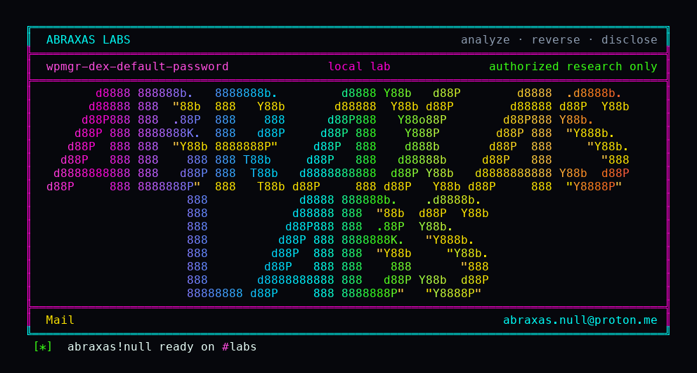

<p align="center">
  
</p>

# wpmgr-dex-default-password

The shipped Docker Compose file puts the web UI and Dex, the sign-in box, on every network interface. Dex still has `admin@wpmgr.dev` / `password` and a client secret of `wpmgr-oidc-dev-secret`. The installer rotates session keys and the bootstrap claim. It never rotates Dex. After someone claims the install, anyone who can reach port 8088 and 5556 can sign in through that default account and create their own organisation.

**Class:** Default credentials
**Reach:** Remote (default compose / quickstart; web `:8088` and Dex `:5556` on `0.0.0.0`)

**WPMgr** `v0.61.199` (`e1b3a163`) - mosamlife

| | |
|---|---|
| ID | no CVE yet |
| Class | **Default credentials** (shipped Dex password on all interfaces) |
| Reach | **Remote** against a default compose stack |
| CWE | [CWE-798](https://cwe.mitre.org/data/definitions/798.html) / [CWE-1188](https://cwe.mitre.org/data/definitions/1188.html) |
| CVSS | **Critical: 9.8** `CVSS:3.1/AV:N/AC:L/PR:N/UI:N/S:U/C:H/I:H/A:H` |
| Product | [WPMgr](https://github.com/mosamlife/wpmgr) |
| Affected | **v0.61.199** (`e1b3a163988c9f1c31bc93922ea34322fa188792`) default `infra/docker-compose.yml` |
| Auth | none. Shipped Dex static password. Instance must already be claimed. |
| License | [GNU Affero GPL v3.0](LICENSE) |
| Lab | loopback 127.0.0.1:18210-18214. Compose `wpmgrh18`. Lab binds loopback only. |

## What an attacker can do

Needs a default compose/quickstart stack reachable on the published web and Dex ports, after first-run claim. `.env.example` leaves `WPMGR_OIDC_ISSUER` empty. Compose still interpolates Dex as the issuer.

| Privilege | Method / sink | Recon / integrity / availability | Lab-proven or inferred |
|---|---|---|---|
| Confirm shipped Dex user and secret on the pin | `infra/dex/config.yaml` `admin@wpmgr.dev` / bcrypt of `password`, `wpmgr-oidc-dev-secret` | Recon | Lab-proven. Pin asserts |
| Confirm web and Dex publish on `0.0.0.0` | `infra/docker-compose.yml` `:8088` and `:5556` | Recon | Lab-proven. API stays `127.0.0.1` |
| Confirm `init-env.sh` never rotates Dex | `scripts/init-env.sh` | Recon | Lab-proven. Pin assert |
| SSO as the shipped Dex user | `GET /auth/oidc/login` → Dex password `admin@wpmgr.dev` / `password` | Integrity (authn) | Lab-proven. `wpmgr_session` |
| Create a tenant as that session | `POST /api/v1/orgs` | Integrity (tenant create) | Lab-proven. 201 org id |

**Stays closed on this leftover**

| Axis | Method / sink | Why it is closed |
|---|---|---|
| Integrity | First-run ownership | Claim-gated. `registration_closed` until an owner exists |
| Integrity | API port | Bound `127.0.0.1` on the product compose |
| Integrity | Helm | Empty `.gitkeep`. No chart |
| Integrity | Postgres app role | `wpmgr_app` is `NOSUPERUSER NOBYPASSRLS` |
| Integrity | SeaweedFS S3 secret | `init-env.sh` rewrites it on the recommended path |

The lab compose never bound `0.0.0.0`. The leftover is the product file. I asserted that bind in the pin before talking to loopback Dex.

## How I found it

`docs/install.md` and `scripts/quickstart-selfhost.sh` wait on Dex. Empty `WPMGR_OIDC_ISSUER=` in `.env.example` still loses to compose `:-http://dex.localhost:5556/dex`. Skip-approval is on. That is a default-credential leftover on a published identity port, not a misconfiguration overlay.

Wrong turns: treating Grafana anonymous Admin as this slot (`--profile observability` only); treating SeaweedFS `wpmgr-dev-secret` as this slot (init-env rotates it).

## Lab

```bash
python3 wpmgr-dex-default-password-Abraxas-Labs.py
```

or:

```bash
cd lab
./run.sh
```

Clones [mosamlife/wpmgr](https://github.com/mosamlife/wpmgr) at `e1b3a163` into `lab/src`. Loopback only. Refuses to start if the lab compose itself publishes a non-loopback bind.

```text
IOC pin-bind web=0.0.0.0:8088 dex=0.0.0.0:5556 api=127.0.0.1:8081
IOC pin-dex admin@wpmgr.dev bcrypt-password client=wpmgr-oidc-dev-secret
IOC pin-init-env never-rotates-dex
IOC dex-sso=admin@wpmgr.dev session=1
IOC org-id=c91a0590-f8ea-4af2-bc25-b5e8894ae330
SUCCESS WPMGR-H18-DEX-DEFAULT WPMGR-H18-DEX-CREATED-TENANT
```

## The fix

Bind Dex and the web UI to `127.0.0.1` the way the API already is, or require an explicit publish. Generate the Dex static password and client secret in `init-env.sh`. Do not enable OIDC when `.env` leaves the issuer empty. Delete `admin@wpmgr.dev` from the shipped config.

## References

- [github.com/mosamlife/wpmgr](https://github.com/mosamlife/wpmgr) `e1b3a163988c9f1c31bc93922ea34322fa188792`
- [`infra/docker-compose.yml`](https://github.com/mosamlife/wpmgr/blob/e1b3a163988c9f1c31bc93922ea34322fa188792/infra/docker-compose.yml)
- [`infra/dex/config.yaml`](https://github.com/mosamlife/wpmgr/blob/e1b3a163988c9f1c31bc93922ea34322fa188792/infra/dex/config.yaml)
- [`scripts/init-env.sh`](https://github.com/mosamlife/wpmgr/blob/e1b3a163988c9f1c31bc93922ea34322fa188792/scripts/init-env.sh)
- [CWE-798](https://cwe.mitre.org/data/definitions/798.html) · [CWE-1188](https://cwe.mitre.org/data/definitions/1188.html)

## License

GNU Affero GPL v3.0. See [LICENSE](LICENSE). Loopback lab only. No warranty.

Abraxas Labs
abraxas.null@proton.me
